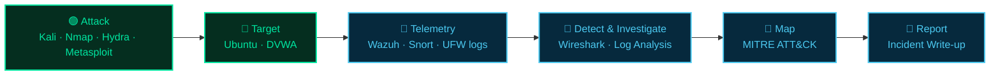

<div align="center">

<a href="https://github.com/GadeKuldeep"></a>

<br>


-4CC9F0?style=for-the-badge&labelColor=0d1117)


</div>

---

## `$ whoami`

```bash
analyst@kuldeep:~$ cat profile.conf

NAME        = "Kuldeep Gade"
EDUCATION   = "B.E. Computer Engineering (Cybersecurity) | SPPU"
EXPERIENCE  = "Cybersecurity Intern @ UptoSkills"
MISSION     = "Understand how attacks happen, how they are detected, how teams respond"
METHOD      = "Build labs -> break things -> read the logs -> write it up"
EXPLORING   = ["Threat Hunting", "Network Forensics", "SOAR", "AI/ML for Security"]
```

---

## 🧭 Lab Pipeline: How I Practice



---

## 🛠️ Toolkit

<table>
<tr>
<td width="50%" valign="top">

### 🔵 Blue Team


</td>
<td width="50%" valign="top">

### 🟢 Red Team


</td>
</tr>
<tr>
<td colspan="2" valign="top">

### ⚙️ Build & Platform


</td>
</tr>
</table>

---

## 📁 Case Files

| Case | Project | Stack | What I Did |
|:---:|:---|:---|:---|
| `#001` | [🔴🔵 Red Blue Team Lab Setup](https://github.com/GadeKuldeep/Red-Blue-Team-Lab-Setup) | Kali, Ubuntu, DVWA, Wazuh, Snort, UFW | Simulated attacks, monitored them with SIEM + IDS, mapped to MITRE ATT&CK, wrote incident reports |
| `#002` | [🌐 Network Traffic Analysis Lab](https://github.com/GadeKuldeep/Network-Traffic-Analysis-Lab) | Wireshark, PCAP, TCP/IP, DNS, HTTP | Investigated suspicious traffic and malware-related communication, documented findings |
| `#003` | [🔍 Google Dorking 2026](https://github.com/GadeKuldeep/Google-Dorking-2026) | OSINT, search operators | Reference guide for recon and public-exposure awareness (authorized use only) |
| `#004` | [🛡️ AlertMatrix](https://github.com/GadeKuldeep/AlertMatrix) | React, Vite, Express, FastAPI, MongoDB | Domain scanner: DNS, SSL/TLS, security headers, port scan, reporting |

---

## 🎯 Learning Roadmap

| Stage | Focus | Progress |
|:---|:---|:---|
| 🟢 Foundation | SOC workflows, SIEM and IDS basics |  |
| 🟢 Detection | Threat detection & investigation |  |
| 🔵 Adversary Study | MITRE ATT&CK & TTP analysis |  |
| 🔵 Forensics | Network & Windows forensics |  |
| 🔵 Automation | Python security automation, SOAR |  |
| ⚪ Next | AI/ML for cybersecurity, cloud security |  |

<sub>Progress bars are my own self-assessment. Edit the numbers in the URLs to match where you are.</sub>

---

## 📊 Telemetry

<div align="center">


</div>

---

<div align="center">

### 📡 Open Channel

[](https://www.linkedin.com/in/kuldeepgade)
[](https://github.com/GadeKuldeep)

<br>

```
"Don't just learn the tool. Understand the problem it solves."
```

**`Learn. Build. Investigate. Improve.`** 🔐

</div>


